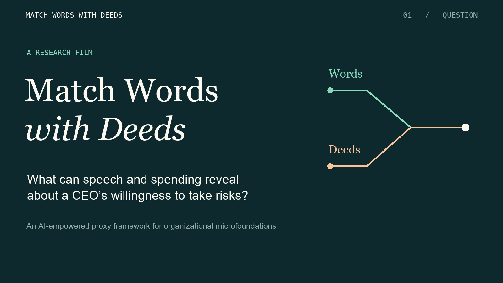
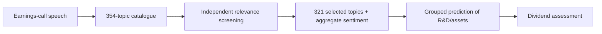

# WordDeed

**Match Words with Deeds: An AI-Empowered Proxy Framework for Organizational Microfoundations**

WordDeed connects what organizations say with what they do to construct and assess proxies for latent beliefs, preferences, and traits. Its contribution is a researcher-directed AI workflow in which semantic judgments become explicit measurement inputs: readers select relevant narrative features, numerical tools learn their relationship with a behavioral anchor, and researchers evaluate the resulting proxy in a separate empirical setting.

This repository is the research supplement for the proposal to the Organization Science special issue on [AI-Enabled Frontiers in Organizational Science](https://orgsci.org/). CEO risk preference is the first packaged application. The framework is intended for multiple constructs; each new application needs its own scientific specification and compatible numerical adapters.

**Read:** [Proposal (PDF)](docs/resources/proposal.pdf) · [Final technical appendix (Word)](docs/resources/technical-appendix.docx) · [Reviewer guide](docs/REVIEWER_GUIDE.md)

**Explore:** [Project website](https://astounding-entremet-7d220b.netlify.app/) · [Research film](docs/video/research/match-words-with-deeds.mp4) · [Transcript](docs/video/research/transcript.md) · [Results](RESULTS.md) · [Replication](REPLICATION.md)

## The measurement problem

Organizational theories often rely on individual beliefs or preferences that cannot be observed directly. Behavioral proxies face an attribution problem: investment may reflect a leader’s preferences, but also opportunities and constraints. Narrative proxies face an authenticity problem: public communication may reflect a perspective, but also impression management and contextual information.

WordDeed learns the component of a theoretically justified behavior that can be predicted from construct-relevant narrative features. Predictions for observations held out of model fitting form the **synthesized proxy**. Shared circumstances may drive both language and behavior, so predictive alignment alone cannot establish a latent trait. The workflow separates construction from evidence about validity.

## Four steps

| Step | Research task | Inspectable output |
| --- | --- | --- |
| **1. Characterize the corpus** | Represent recurring content using embeddings and topic discovery, before assigning construct relevance. | A fixed topic catalogue, densities, and observation identities. |
| **2. Screen topics** | Three independent LLM readers assess descriptors, then review common source passages in their own histories. An unweighted two-of-three vote determines relevance. | Selected topic IDs, individual reasons, source evidence, missing responses, and minority votes. |
| **3. Synthesize the proxy** | Predict a behavioral anchor from the selected narrative features using grouped cross-fitting and training-data tuning. | Held-out predictions, fitted models, folds, and diagnostics. |
| **4. Evaluate the measure** | Examine a separate outcome, comparisons with existing proxies, sensitivity, and alternative explanations. | Empirical estimates and an explicit account of what they support. |

A coordinator invokes stage-specific tools, verifies outputs, records progress, and resumes saved work. LLM readers supply semantic judgments; Python and statistical programs perform the numerical work. Researchers set the construct, relevance criteria, behavioral anchor, and interpretation. Read the [workflow](docs/WORKFLOW.md) and [runtime guide](agent_system/empirical/README.md).

[](docs/video/research/match-words-with-deeds.mp4)

The 4:30 research film follows a disputed topic through voting, grouped prediction, dividend assessment, and the next validation tests. Its updated narration includes the final appendix’s Table A13. English narration is synthesized with Kokoro.

[Watch or download MP4](docs/video/research/match-words-with-deeds.mp4) · [Accessible transcript](docs/video/research/transcript.html) · [English captions](docs/video/research/captions.en.vtt) · [Film source](production/research-film/README.md)

## First application: CEO risk preference

The [CEO application](applications/ceo-risk-preference/README.md) uses earnings-call speech, R&D intensity as the behavioral anchor, and dividend payment as a separate empirical outcome.



| Evidence | Finding | Scope |
| --- | --- | --- |
| **Topic screening** | Twelve two-stage trials, 36 readers. Descriptor screening retains 66–87 topics; passage review retains 313–321. | The reported mapping uses one adopted 321-topic selection. Agreement measures repeatability, not accuracy. |
| **Behavioral prediction** | 29,506 firm-years scored; cross-fitted R² is 0.5351 for Ridge and 0.6128 for XGBoost on 29,191 available targets. | 321 transformed topic densities plus one aggregate sentiment feature; no firm controls or fixed effects in this mapping. The target is contemporaneous R&D/assets. |
| **Dividend assessment** | Negative synthesized-proxy coefficients in all 16 score specifications within the original 25-model package. | Conditional associations, including models controlling for actual R&D and other firm and CEO characteristics. |
| **Final appendix extension** | Table A13 adds eight models with both a narrative proxy and actual R&D controls. Synthesized-proxy coefficients remain negative and significant at the 1% level; inside-debt estimates are −0.146 for Ridge and −0.141 for XGBoost. | Author-reported appendix results. The existing connected reproduction covers the original 25 models, not these eight extensions. |

[Complete released results](applications/ceo-risk-preference/RESULTS.md) · [Verified reproduction](applications/ceo-risk-preference/REPLICATION.md) · [Document versions and evidence scope](docs/resources/README.md)

The connected reproduction checks the saved topic representation and replays saved reader judgments, then refits Ridge/XGBoost and estimates the original 25 downstream models. It does not retrain topic discovery, regenerate sentiment, or obtain new AI judgments. Missing R&D handling, historical row alignment, selection after preliminary performance inspection, and shared firm circumstances remain relevant limitations. Psychological validity and superiority over alternative measures remain empirical questions.

## What comes next

The final appendix proposes carrying alternative AI judgments through the full measurement process: refit all twelve selections, compare conventional feature selection, average predictions, and test selection-informed Ridge penalties. Independent human review, common-sample performance comparisons, and examination of shared firm or industry causes will test the interpretation of the proxy.

The proposal also reports a political-ideology trial using donation records. Its empirical materials are not packaged here. See the [roadmap](docs/ROADMAP.md) for the distinction between completed work and proposed extensions, and [developing an application](docs/NEW_APPLICATION.md) for the shared workflow’s current boundaries.

## Run the prototype

The offline demonstration needs **Python 3.11+** and only the standard library:

```sh
git clone https://github.com/jianghan6666/worddeed.git
cd worddeed
python3 -m agent_system.empirical.demo --out .local/demo
python3 -m agent_system.empirical.demo --out .local/demo --resume
```

Use a fresh output directory for the first run. Inspect `summary.json`, `workflow/state.json`, and `workflow/events.jsonl`. The coordinator, handoffs, state checks, and resume logic execute; model replies and numerical outputs are explicit fixtures. No API key, empirical data, model training, or Stata is needed for this demonstration.

For empirical execution, follow the [reviewer guide](docs/REVIEWER_GUIDE.md) and [CEO replication instructions](applications/ceo-risk-preference/REPLICATION.md). They identify input packages, pinned environments, the verified Windows refit route, and Stata estimation requirements.

To preview the updated website locally:

```sh
python3 -m http.server 8765 --bind 127.0.0.1 --directory docs
```

Open [the local website](http://127.0.0.1:8765/). The hosted website may show an earlier edition until this update is deployed.

## Work with a research agent

Open the repository in a coding-agent workspace and use this starting prompt:

```text
Act as the coordinator for a WordDeed study. Follow docs/WORKFLOW.md.
Read the application specification, current configuration, and saved handoff.
Help me define the construct, narrative inputs, behavioral anchor, observation
unit, period, and evaluation criteria. Coordinate the four steps using the
existing tools. Preserve reader independence, input identities, missingness,
minority judgments, folds, and completed outputs. Bring scientific decisions
and interpretation to me with the evidence and remaining limits.
Save new inputs and execution records under .local/.
```

## Repository guide

| Location | Contents |
| --- | --- |
| [`docs/`](docs/README.md) | Website, final proposal and appendix, film, workflow, reviewer guide, and roadmap. |
| [`agent_system/`](agent_system/README.md) | Coordinator, contracts, current numerical adapters, and software tests. |
| [`applications/`](applications/README.md) | Application-specific specifications, results, and replication evidence. |
| [`replication/`](REPLICATION.md) | Archive utilities and maintained reproduction drivers. |
| [`production/research-film/`](production/research-film/README.md) | Editable film graphics, narration text, measured captions, and rebuild command. |

Run the self-contained software checks with Python 3.11+:

```sh
python3 -m unittest agent_system.tests.empirical.test_demo agent_system.tests.empirical.test_coordinator agent_system.tests.empirical.test_workflow agent_system.tests.empirical.test_external_inputs -v
```

Source-specific terms apply to study inputs. No open-source license is granted by this repository at present. Software execution, reader agreement, predictive fit, and construct validity answer different questions.
