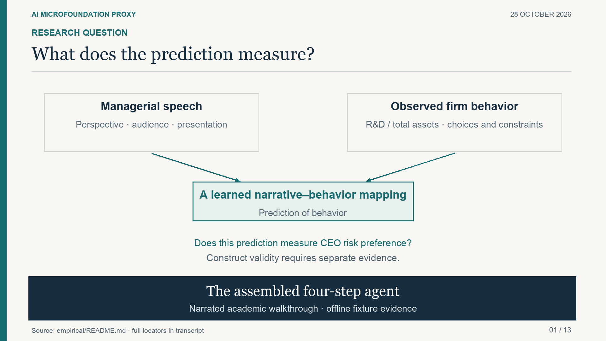
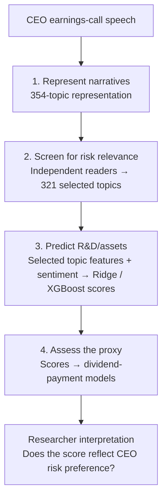

# WordDeed

**Match Words with Deeds: An AI-Empowered Proxy Framework for Organizational Microfoundations**

WordDeed uses what firms say to predict what they do. Researchers can use it to build and assess a proxy for a latent trait, such as CEO risk preference, from evidence in corporate narratives and observed behavior. It provides a shared research workflow and agent orchestration for applications with different constructs, narratives, behavioral targets, and settings. Researchers define the scientific claim and interpret the evidence; agents coordinate the work and call computational tools.

**Reviewing this repository?** Start with the [reviewer guide](docs/REVIEWER_GUIDE.md) for results, fresh ZIP checks and the exact four-step reproduction boundary.

**Start here:** [Workflow](docs/WORKFLOW.md) · [Applications](applications/README.md) · [Develop an application](docs/NEW_APPLICATION.md) · [Results](RESULTS.md) · [Replication](REPLICATION.md)

**[Project website](https://astounding-entremet-7d220b.netlify.app/)** · [Video](https://astounding-entremet-7d220b.netlify.app/#film) · [Roadmap](docs/ROADMAP.md)

## What is WordDeed?

Many organizational theories depend on beliefs, preferences, and judgments that researchers cannot observe directly. Speech offers one source of evidence; choices offer another. WordDeed makes the connection between them explicit and inspectable.

You bring a construct, narrative material, a behavioral outcome, and a study setting. The workflow represents the narrative as topics, screens those topics for relevance, estimates a model linking narrative features to behavior, and passes the resulting scores to downstream analysis. You leave with **selected topics and their reasons, predicted behavioral scores, analysis outputs, and a saved execution record**.

Each application supplies its own scientific specification and validation criteria. The first completed application studies CEO risk preference; its R&D target and financial-data assumptions belong to that case. The coordinator, saved state and resume logic are shared and reusable now. The numerical adapters implement the CEO case, and a second empirical application is roadmap work.

### Terms used here

- **Construct**: the unobserved quality a study is about, such as a CEO's risk preference.
- **Proxy**: an observable measure used to study a latent construct. WordDeed’s synthesized proxy is the fitted value from predicting a behavioral measure using narrative evidence.
- **Microfoundation**: an individual-level belief, preference or judgment that an organizational theory rests on.
- **Narrative**: the spoken or written material, such as earnings-call speech.
- **Topic**: a theme that a topic model finds in the narrative. Each observation has a density for each topic.
- **Reader**: a language-model session that judges whether a topic is relevant to the construct. Readers work independently, and their reasons and dissents are kept.
- **Screening**: the readers' pass over the full topic catalogue that selects the relevant topics.

[](https://astounding-entremet-7d220b.netlify.app/#film)

The video records the earlier assembly and fixture demonstration. The [current replication evidence](applications/ceo-risk-preference/replication/verification/README.md) additionally covers completed empirical refits and estimation.

[Watch the video on the website](https://astounding-entremet-7d220b.netlify.app/#film) · [Download MP4](docs/video/four-step-agent.mp4) · [Read the narration](docs/video/transcript.md) · [English captions](docs/video/four-step-agent.en.vtt).

## How it works

Agents follow explicit workflows and use tools for computation and record keeping. Saved outputs connect the stages. The researcher retains scientific decisions.

| Responsibility | Work | Output |
| --- | --- | --- |
| **Coordinator** | Reads the study configuration, dispatches stages, checks outputs, and resumes saved work. | An integrated execution record. |
| **Topic preparation** | Binds the topic catalogue, density inputs, and observation identities. | Ordered topics and their distributions. |
| **Screening readers** | Independently evaluate topic relevance, then review source passages in their own histories. | Selected topics, reasons, and minority votes. |
| **Proxy estimation** | Fits the specified grouped prediction models. | Scores, folds, models, and fit diagnostics. |
| **Downstream analysis** | Matches scores to the study panel and prepares and estimates the specified models. | Analysis inputs, tables, and diagnostics. |

The executable system has one coordinator and, for fresh screening, three independent readers. Each reader is a separate language-model session with its own history, and no reader sees another's judgments. Topic preparation, proxy estimation, and downstream analysis use Python adapters and scientific programs. The [role guides](docs/agents/coordinator.md) explain these responsibilities.

### Four-step workflow

1. **Represent the narrative.** Bind the topic catalogue and density inputs to the study's observations. Preserve the topic ordering and input identities.
2. **Screen for relevance.** Three readers evaluate the complete catalogue independently. Seal all initial responses before releasing source passages; continue each reader's own history. Export a two-of-three vote with every reason and minority judgment.
3. **Estimate the proxy.** Fit the application's specified narrative-to-behavior model, with explicit target handling, validation splits, and score definitions.
4. **Assess the proxy.** Match scores to downstream observations, estimate the specified models, and examine what the results support and what remains unresolved.

```text
Narrative evidence → Topics → Relevance screening
                                      |
                                      v
                         Behavioral prediction
                                      |
                                      v
                         Downstream assessment
                                      |
                                      v
                       Researcher interpretation
```

The [workflow guide](docs/WORKFLOW.md) connects these steps to the runtime. The coordinator's tools are `get_status`, `run_stage`, `read_result`, and `finish`; saved artifacts determine whether a stage is complete.

## Applications

The [application collection](applications/README.md) keeps each research case's walkthrough, scientific materials, results and replication evidence together. The first completed case is [CEO risk preference](applications/ceo-risk-preference/README.md), using earnings-call speech, R&D investment and dividend decisions:



- **354 topics**, screened in twelve trials. Each trial used three independent language-model readers, 36 reader sessions in all, across two model families, three effort settings and two repetitions.
- **321 selected topics** used with sentiment to predict R&D/assets.
- Scores for **29,506 firm-years**, with cross-fitted R² of **0.5351 for Ridge** and **0.6128 for XGBoost**.
- A downstream analysis with **25 specifications**, including 16 score models.

Read its [full results](applications/ceo-risk-preference/RESULTS.md) and [verified replication](applications/ceo-risk-preference/REPLICATION.md). Its interpretation as psychological risk preference remains a research question. Future applications will sit alongside this case with their own scientific specifications and evidence.

The offline demo below uses invented inputs to demonstrate coordination and resume. To develop a new empirical case, use the [application guide](docs/NEW_APPLICATION.md) and [research template](applications/_template/README.md).

## Quick start

### Run the local demo

Use **Python 3.11 or newer**. The offline demo needs only the standard library.

```sh
git clone https://github.com/jianghan6666/worddeed.git
cd worddeed
python3 -m agent_system.empirical.demo --out .local/demo
python3 -m agent_system.empirical.demo --out .local/demo --resume
```

Start with a new output directory. Inspect `summary.json`, `workflow/state.json`, and `workflow/events.jsonl` inside it. The coordinator, handoffs, state checks, and resume logic execute; model replies and numerical outputs are explicit fixtures. No API key, empirical data, training, or Stata is needed.

For real execution, provide compatible study inputs and scientific packages through local configuration. See the [runtime guide](agent_system/empirical/README.md) for dependencies and external input contracts. The included adapters target the current CEO/R&D specification; another application requires an explicit method adaptation.

### Start prompt

Open this repository in your coding-agent workspace:

```text
Act as the coordinator for a WordDeed study. Follow ./docs/WORKFLOW.md.
Identify the application and read its research specification, current configuration,
and saved handoff first.

Help me state the construct, narrative inputs, behavioral target,
observation unit, period, and intended interpretation. Coordinate topic
preparation, independent relevance screening, proxy estimation, and
assessment through the existing tools.

Preserve input identities, scientific settings, reader independence,
minority judgments, and completed outputs. Bring research decisions
and interpretation to me with the evidence and remaining limits.
Save new inputs and execution records under .local/.
```

### Open the introduction

Visit the [live project website](https://astounding-entremet-7d220b.netlify.app/) to explore the method and play the video. To run it locally:

```sh
python3 -m http.server 8765 --bind 127.0.0.1 --directory docs
```

Open [the local introduction](http://127.0.0.1:8765/). `Ctrl+C` stops the server.

## Example prompts

| Task | Prompt to the coordinator |
| --- | --- |
| **Frame** | “State the construct, unit, period, behavioral target, and intended use of the proxy. Identify the decisions I need to make.” |
| **Prepare** | “Check topic identities and observation alignment. Explain which links are verified and which depend on supplied provenance.” |
| **Screen** | “Run the agreed independent-reader protocol and retain all reasons, missing responses, and minority votes.” |
| **Estimate** | “Use the agreed prediction method. Show the sample, target handling, folds, and diagnostics.” |
| **Assess** | “Explain what the results support, competing interpretations, and the next useful validation.” |
| **Resume** | “Verify saved outputs, resume the next unfinished stage, and leave a concise handoff.” |

## Repository layout

Shared infrastructure stays at the root; application-specific research and deliverables live under `applications/<application-name>/`.

```text
worddeed/
|-- README.md                 Framework overview and setup
|-- AGENTS.md                 Instructions for coding agents
|-- RESULTS.md                Index of application results
|-- REPLICATION.md            Index of application reproduction packages
|-- agent_system/             Runtime, contracts, current adapters, and tests
|-- docs/                     Shared workflow, roles, protocols, and extension guide
|-- applications/
|   |-- README.md             Application collection
|   |-- _template/            Research and implementation planning template
|   `-- ceo-risk-preference/   First complete application
|       |-- README.md         Research question and walkthrough
|       |-- study/            Representation, screening, prediction, assessment
|       |-- summary/          Selected aggregate findings
|       |-- results/          Complete reports, scores, tables, and reader evidence
|       |-- replication/      Application inventories and verification receipts
|       |-- RESULTS.md        Results guide
|       `-- REPLICATION.md    Exact reproduction instructions
|-- replication/              Archive utilities and current reproduction drivers
|-- .github/workflows/        Software, results, and empirical verification checks
|-- .gitattributes            Preserve inventoried bytes across platforms
`-- .gitignore                Exclude local inputs, runs, and environments
```

The [repository guide](docs/REPOSITORY.md) explains the framework/application boundary and historical paths. Use ignored `.local/<application-name>/` for new inputs and runs. Each application's replication guide provides access to its authorized large datasets, models and complete evidence archives.

## Roadmap

The CEO application has passed a [fresh-download connected reproduction](applications/ceo-risk-preference/REPLICATION.md). The [roadmap](docs/ROADMAP.md) develops reusable application interfaces, a second empirical case, stronger input and screening evidence, and construct validation. Each milestone identifies the evidence needed for completion.

## Design principles

- **Let the researcher set the measurement claim.** Construct definition, scientific specifications, and interpretation remain research decisions.
- **Connect stages through explicit outputs.** Preserve topic identities, observation keys, folds, and score files.
- **Keep judgments inspectable.** Retain independent readings, reasons, disagreement, and missingness.
- **Distinguish different kinds of evidence.** Software execution, reader agreement, predictive fit, and construct validity answer different questions.
- **Make work resumable.** Save inputs, decisions, outputs, and failures so another session can continue.

## Checks and use

Run the self-contained tests with Python 3.11+:

```sh
python3 -m unittest agent_system.tests.empirical.test_demo agent_system.tests.empirical.test_coordinator agent_system.tests.empirical.test_workflow agent_system.tests.empirical.test_external_inputs -v
```

Application results distinguish supplied findings from newly executed verification; software checks do not establish construct validity. Source-specific terms apply to any study inputs you provide. No open-source license is granted by this repository at present.
